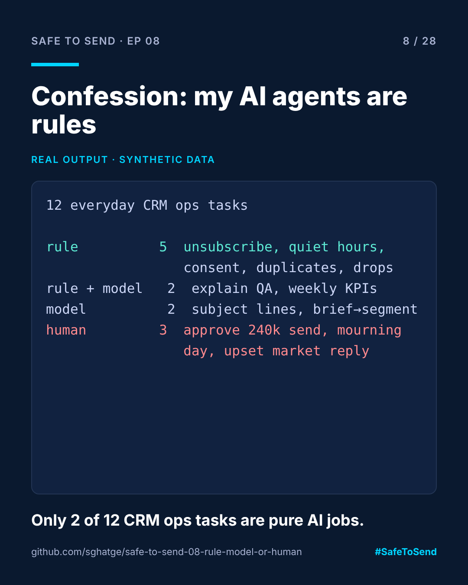

# safe-to-send-08 · Rule, Model or Human?



**Safe to Send · Episode 08** — a 28-day learn-in-public series on governing AI in CRM operations.

> Confession: the "AI agents" in my CRM workbench don't call a model. That was deliberate.

## The real-world scenario

A team decides to "add AI" to campaign operations and starts with the most visible task. Six weeks later, a model is checking unsubscribe links (a regex does that perfectly) while a human still writes every status reply by hand (the one thing a model is genuinely good at).

## The use case

Before automating any CRM task, ask four questions:

1. Is there one correct answer you could write as a rule?
2. Does it need reading or writing natural language?
3. Does it need judgement or unwritten context?
4. Would someone have to answer for it?

The answers decide the owner: **rule**, **model**, **rule + model** (rule decides, model explains) or **human**.

## Run it

```bash
python triage.py examples/crm_ops_tasks.json
```

## Real example output (12 everyday CRM ops tasks)

```
human: 3 | model: 2 | rule: 5 | rule + model: 2
```

| Owner | Tasks |
|---|---|
| rule | unsubscribe check, quiet hours, consent filter, duplicate sends, open-rate drop |
| rule + model | explain a failed QA check; summarise weekly KPIs (with human approval) |
| model | draft subject-line options; turn a brief into a draft segment definition |
| human | send-during-mourning call, approving a 240k send, replying to a delayed market |

Only 2 of 12 tasks are pure model jobs, and 4 involve a model at all. That's why my workbench started with rules.

## Where this fits

Week 2 of the series adds a model to a rules-first workbench, step by step. See [crm-ai-agent-platform](https://github.com/sghatge/crm-ai-agent-platform) for the 8 rule-based workflows this started from.

MIT · [Sangram Ghatge](https://www.linkedin.com/in/sangram-g-2369705b) · #SafeToSend
